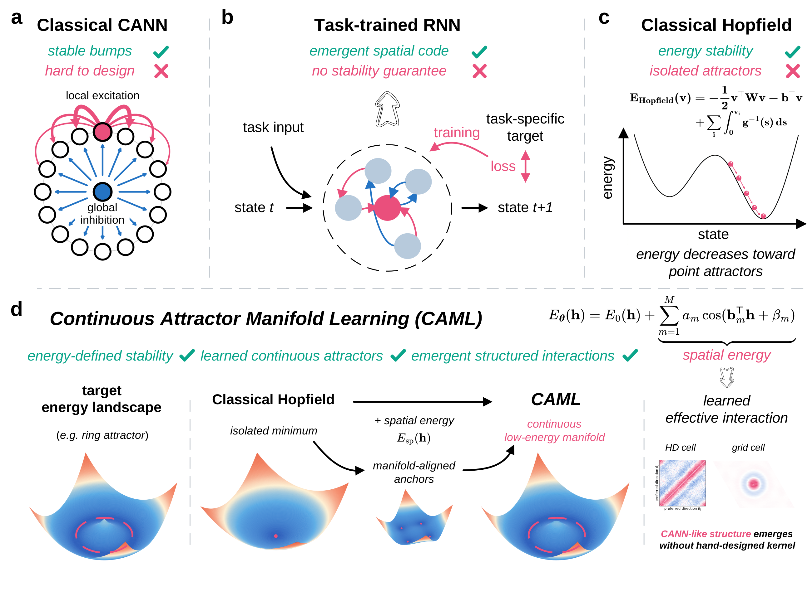
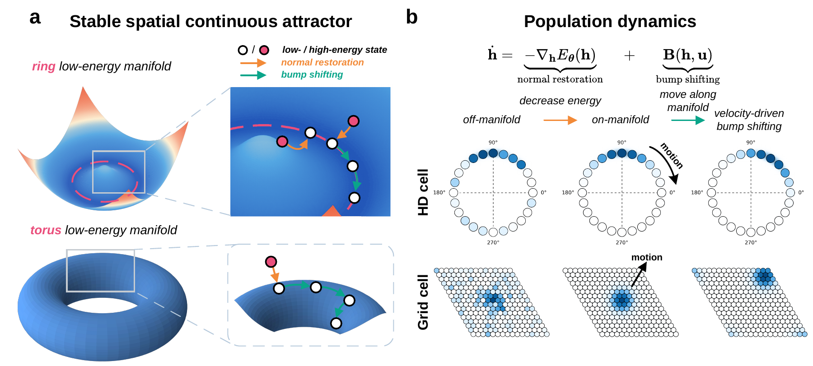

# CAML

Official implementation of **A Theory of Continuous Attractor Manifold Learning
for Spatial Cognition** (NeurIPS 2026).

Chong Li, Xiangyang Xue, Jianfeng Feng, Taiping Zeng.

[Paper and project page](https://birlabs.github.io/CAML/)

CAML learns energy-based continuous attractor dynamics for head-direction,
grid-cell, and place-cell representations without hand-designing recurrent kernels.



## Method

An energy gradient provides **normal restoration** toward the population manifold.
A velocity-dependent **bump shifting** field moves activity along the manifold
for path integration.



## Setup

```bash
conda env create -f environment.yml
conda activate caml
```

## Pretrained checkpoints

Download `checkpoints.tar.gz` from the
[release assets](https://github.com/birlabs/CAML/releases) and extract it in this directory:

```bash
tar -xzf checkpoints.tar.gz
```

The archive contains energy and bump-shifting weights for HD, Grid, and Combined Place.

## Evaluation

```bash
jupyter lab evaluation.ipynb
```

Run the notebook's Setup cell, then the experiment sections below.
An NVIDIA GPU is recommended; CPU execution is supported.

| Section | Paper result |
| --- | --- |
| Noise recovery | Table 1, CAML entries for HD and Grid |
| HD/Grid path integration | Table 2, HD and Grid |
| Place path integration | Table 2, Combined Place |

The notebook loads the weights, runs each evaluation, and displays means and
standard deviations. Results are saved to `results/table1_caml.csv` and
`results/table2_tracking.csv`. Evaluation settings are described in the notebook.

## Citation

```bibtex
@inproceedings{li2026caml,
  title={A Theory of Continuous Attractor Manifold Learning for Spatial Cognition},
  author={Li, Chong and Xue, Xiangyang and Feng, Jianfeng and Zeng, Taiping},
  booktitle={Advances in Neural Information Processing Systems},
  year={2026}
}
```

## License

[Apache-2.0](LICENSE).
